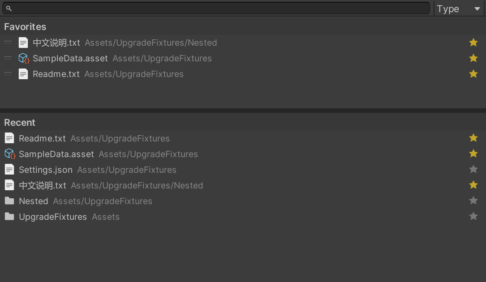
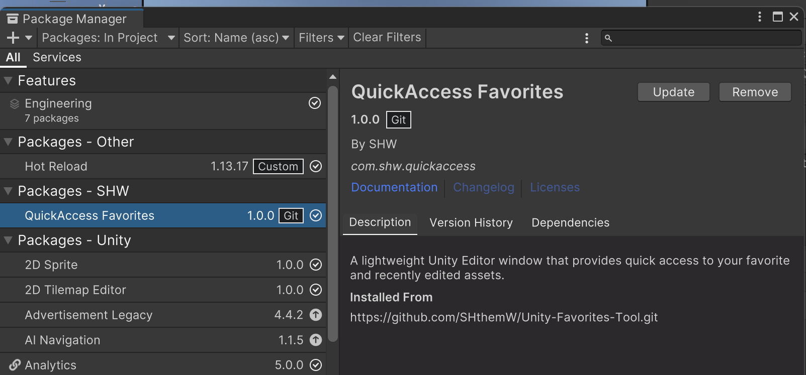
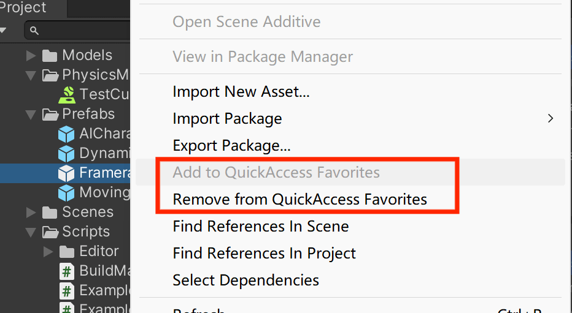

# Unity QuickAccess - Favorites Tool

[English](README.md) | [简体中文](README_CN.md)

Keep favorite assets and recently edited resources close at hand, with search, type filters, and drag reordering.

<p align="center">
  
</p>

## Features

- **Favorites and ordering**: Star assets and drag the left handle to reorder them.
- **Recent assets**: Track the last 50 assets saved or imported.
- **Search and filters**: Filter favorites and recent assets by name or type.
- **Project storage**: Keep records across restarts and favorites across asset moves or renames (preserve `.meta` files).
- **Interface**: Follow the editor theme and resize panels with the splitter.

## Installation

In **Window > Package Manager**, select **+ > Add package by git URL...** and enter:

```text
https://github.com/SHW2002/Unity-Favorites-Tool.git
```

<p align="center">
  
</p>

Alternatively, copy the repository's `Editor` folder and `com.shw.favoritestool.asmdef` into your project's `Assets` folder.

## Usage

Open **Window > QuickAccess** or **Tools > QuickAccess**, or press `Ctrl+Shift+Q` / `Cmd+Shift+Q`.

| Action | Method |
| --- | --- |
| Add or remove a favorite | Click the star on the right |
| Select and locate an asset | Single-click the row |
| Open an asset | Double-click the row |
| Reorder favorites | Clear search, then drag the left handle |
| Resize panels | Drag the splitter between Favorites and Recent |

The Project context menu also provides **Add to QuickAccess Favorites** and **Remove from QuickAccess Favorites**.

<p align="center">
  
</p>

Drag near the list edges to scroll while reordering. Press Esc or release outside the list to cancel. Recent keeps its automatic editing order.

### Search

The toolbar filters both lists without changing their order. Search by name (`Player`), type (`t:prefab`, `t:SceneAsset`), or both (`Player t:prefab`). Searches are case insensitive.

Use **Type** for common asset types. Results update after a short pause in typing. Clear search to restore all entries and enable reordering.

### Storage and Upgrades

Settings are saved in the project's `UserSettings/QuickAccessSettings.asset`. Add `/UserSettings/` to your Git ignore rules and keep it when moving projects or computers.

On first use, resolvable assets from legacy EditorPrefs are migrated in order, with project-specific records taking priority. Legacy records are preserved; changes made in the new version are not synced back to older versions. Deleting the settings file triggers migration again.

## Requirements

Unity 2021.3 or later.

## License

MIT
